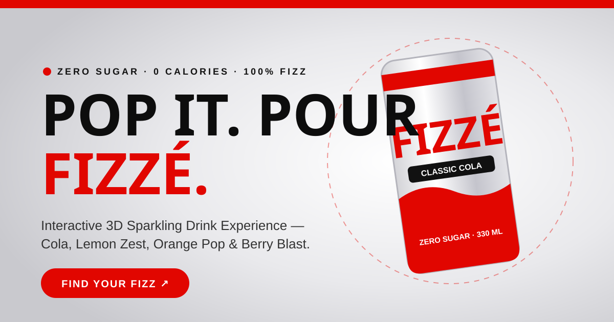

# 🥤 FIZZÉ — Pop. Pour. Fizz.

**FIZZÉ** is an interactive 3D scrollytelling and D2C sparkling beverage experience built with **Three.js**, **GSAP ScrollTrigger**, **Lenis Smooth Scroll**, and **Vite**.

🔗 **Live Website:** [https://fizze.vercel.app/](https://fizze.vercel.app/)



---

## ✨ Key Features

- **Procedural 3D Cans (`Three.js` + `HTML5 Canvas`):** Real-time 3D metallic cans featuring wrap-around high-DPI labels, nutrition tables, barcodes, realistic double-ring pull-tabs, and 100+ ice-cold condensation droplets.
- **Scroll-Driven 3D Pour Ritual (`GSAP ScrollTrigger`):** Interactive pinned section where scrolling cracks open the pull-tab, tilts the can, and pours glowing ruby-red sparkling drink with bobbing ice cubes and 160+ rising carbonation bubbles.
- **Live Flavour Morphing Switcher:** Switch the hero 3D can, rim lighting, and site accent theme live between **Classic Cola**, **Lemon Zest**, **Orange Pop**, and **Berry Blast**.
- **Interactive 360° 3D Product Cards & Quick View:** Every product card renders a live auto-spinning, drag-to-rotate 3D can powered by a single shared offscreen WebGL renderer for 60fps performance.
- **"Your Name on the Can" 3D Personalizer:** Type any name to see it printed live in 3D (`★ MADE FOR SAUMYA ★`) on the rotating metallic can and add the custom pack directly to the cart.
- **Shoppable Mixology Video Reels:** Auto-scrolling vertical video cards with rotating step captions, fullscreen reel modal, and 1-click Add to Cart.
- **Interactive Mixology Recipe Builder:** Step-by-step mocktail recipes paired with video previews and instant ingredient cart integration.
- **Synthesized ASMR Audio Engine (`Web Audio API`):** Procedural metallic can-crack, pressurized hiss, fizzy liquid pour, and bubble pop sound effects with a header toggle.
- **Zero-Friction WhatsApp Checkout:** Persistent slide-out cart drawer (`localStorage`) with pre-filled WhatsApp order messages.

---

## 🛠️ Tech Stack

- **3D & WebGL:** [Three.js](https://threejs.org/) (`RoomEnvironment`, `MeshPhysicalMaterial`, `InstancedMesh`)
- **Animations:** [GSAP](https://gsap.com/) + `ScrollTrigger`
- **Smooth Scrolling:** [Lenis](https://lenis.darkroom.engineering/)
- **Audio:** Web Audio API (procedural synthesis)
- **Build Tool:** [Vite](https://vitejs.dev/)

---

## 🚀 Run Locally

```bash
# Install dependencies
npm install

# Start local dev server
npm run dev

# Build for production
npm run build
```

---

Designed & developed by **Saumya Bansal** · © 2026 **FIZZÉ**

